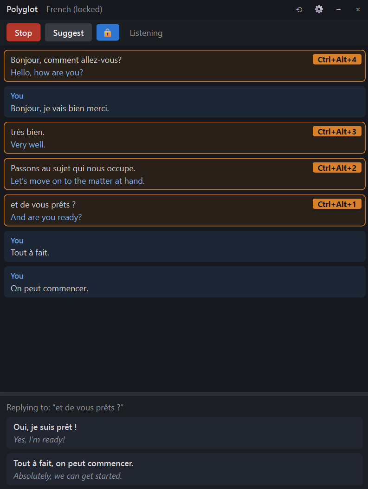
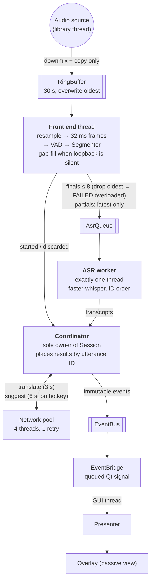

# Polyglot

[](https://github.com/Yalhash/PythonPolyglot/actions/workflows/ci.yml)
[](https://github.com/Yalhash/PythonPolyglot/releases/latest)
[](pyproject.toml)
[](#download)
[](LICENSE)

**Follow a conversation in a language you're still learning.** Polyglot is a small window
that sits beside your call, writes down what the other person says, translates it, and
suggests replies you can say back in their language.

<p align="center">
  
</p>

*A French conversation. Each of their sentences shows the original and the English
translation, your own lines are marked "You", and the bottom panel offers two replies to
"et de vous prêts ?", in French with the English underneath. Click a reply to copy it.*

## What it does

* **Transcribes on your computer.** Speech recognition runs locally. Audio never leaves
  your machine.
* **Translates as they speak**, sentence by sentence, into your language.
* **Suggests replies** in their language when you press a hotkey, with your language
  underneath so you know what you are saying. You can reply to their latest sentence or to
  any of their last few.
* **Knows who you are.** Fill in a short profile once (your name, role, what you want from
  the conversation) and replies sound like you.
* **Keeps your notes to yourself.** On Windows, the window is left out of screen sharing,
  so your translations and profile are not broadcast when you share your screen.

Polyglot works for any conversation where you understand some of the other language, but
not all of it: a meeting with colleagues abroad, a call with family, a language exchange, a
doctor's appointment or a landlord in a new country.

## Download

| | |
| --- | --- |
| **Windows 10/11** | Download `Polyglot-…-windows-x64.zip` from the [latest release](https://github.com/Yalhash/PythonPolyglot/releases/latest), unzip it anywhere, and open `Polyglot.exe` inside the folder. |
| **macOS (Apple Silicon)** | Download `Polyglot-…-macos-arm64.zip` from the [latest release](https://github.com/Yalhash/PythonPolyglot/releases/latest), unzip it, and drag **Polyglot** into Applications. |
| **Intel Macs, Linux** | [Install from source](#install-from-source). |

**"Windows protected your PC" or "Apple could not verify Polyglot"?** The app is not
code-signed yet, so your computer warns you the first time.

* Windows: click **More info → Run anyway**.
* macOS: open **System Settings → Privacy & Security**, scroll down, and click
  **Open Anyway** next to Polyglot.

The first time you start listening, Polyglot downloads its speech model (about 150 MB).
After that it works offline, apart from the optional translation and suggestions.

## First use

1. **Open Polyglot.** A small window appears and stays on top of your other windows.
2. **Choose what to listen to** (Settings ⚙ → Audio → Listen to).
   * Windows: leave it on the default. Polyglot hears whatever your computer plays.
   * macOS: install the free [BlackHole](https://github.com/ExistentialAudio/BlackHole)
     audio driver first and pick it here. The [user guide](docs/USER_GUIDE.md#audio)
     walks you through it.
3. **Set their language** (Settings → Speech → Their language), or leave it on automatic.
4. **Turn on translation and replies** (optional). Paste an
   [OpenAI API key](#translation-and-replies-need-an-api-key) in Settings → Translation,
   tick "Translate", and on the Suggestions tab tick "Suggest replies".
5. **Press Start** and join your call. Each sentence appears when the speaker pauses.
   Press **`Ctrl+Alt+S`** for replies, and click one to copy it.

### Hotkeys

These work even while your call app is in front.

| Action | Keys |
| --- | --- |
| Suggest replies to their last sentence | `Ctrl+Alt+S` |
| Suggest replies to an earlier sentence | `Ctrl+Alt+1` (newest) … `Ctrl+Alt+4` (shown on each sentence) |
| Show / hide the window | `Ctrl+Alt+H` |
| Keep following the newest sentence | `Ctrl+Alt+L` |

On macOS, allow Polyglot under System Settings → Privacy & Security → Accessibility for
hotkeys to work.

### Translation and replies need an API key

Transcription is free and offline. Translation and reply suggestions use OpenAI (or
Google, for translation only), which you pay for by use:

1. Create an account at [platform.openai.com](https://platform.openai.com), add a payment
   method, and create a key under **API keys**.
2. Paste it into Polyglot under Settings → Translation → OpenAI API key.

Each request is a sentence or two of text, so a conversation typically costs very little;
see [OpenAI's pricing](https://openai.com/api/pricing/) for current rates. The key is kept
in your system's keychain, never in a file.

## Privacy

| What | Where it goes |
| --- | --- |
| Audio | Nowhere. It is transcribed on your computer and discarded. |
| Transcribed text | Sent to OpenAI or Google only if you turn on translation or suggestions. |
| Your profile ("About you") | Sent with each reply request, so it only asks for things you would say out loud. |
| API keys | Your system's keychain (Windows Credential Manager or macOS Keychain). |
| Logs | Kept on your computer, with no transcript text unless you turn it on. |

**Ask before you transcribe.** Let the people you are talking with know you are using a
transcription and translation tool. Rules on recording conversations differ between
countries and workplaces, and following them is up to you.

## Limitations

* **Hiding from screen sharing works on Windows only.** macOS 15 and later no longer let
  apps opt out of screen capture, so on a Mac the window shows a "visible in screen share"
  notice instead.
* **A sentence appears once the speaker pauses**, not word by word. How quickly depends
  on your computer and the speech engine.
* **Accuracy depends on audio quality.** Crosstalk, heavy accents and background noise
  lead to mistakes, so treat the text as a guide.
* **Speech engines differ.** Whisper covers 99 languages; Parakeet is faster but covers 25
  European ones. See [speech engines](docs/USER_GUIDE.md#speech-engines).

## Troubleshooting

* **Nothing appears when they talk.** Check Settings → Audio → Listen to. On macOS, make
  sure the call's sound goes to your Multi-Output Device with BlackHole in it.
* **My own words show up as theirs.** Use headphones. With speakers, the call audio and
  your microphone pick each other up.
* **Wrong language, or gibberish.** Set Settings → Speech → Their language instead of
  automatic. Click the language label in the title bar to let it detect again.
* **It's slow.** Choose a smaller Whisper model, or switch to Parakeet for European
  languages (Settings → Speech).
* **No translation or replies.** Check the API key, and that "Translate" and "Suggest
  replies" are ticked.

Everything else, from model choices to every setting, is in the
**[user guide](docs/USER_GUIDE.md)**.

---

## For developers

### Install from source

Needs [Git](https://git-scm.com/downloads), Python 3.10+ and
[uv](https://docs.astral.sh/uv/getting-started/installation/).

```bash
git clone https://github.com/Yalhash/PythonPolyglot.git
cd PythonPolyglot
uv sync                  # creates .venv with the exact locked versions
uv run polyglot --demo   # try the window with synthetic audio: no models, keys or network
uv run polyglot          # the real thing
```

Optional speech engines: `uv sync --extra parakeet` and/or `--extra qwen3`.

### Command line

```bash
uv run polyglot --file recording.wav --fast   # transcribe (and translate) a WAV file
uv run polyglot --headless                    # listen live, print to the terminal
uv run polyglot --list-devices                # list input and loopback devices
uv run polyglot --self-check                  # check every native dependency loads
```

### Tests and tooling

```bash
uv run pytest            # fast suite: no models, devices or network
uv run pytest -m slow    # real Whisper tiny + Silero (needs espeak-ng); Parakeet/Qwen3 if installed
uv run ruff check . && uv run ruff format .
uv run mypy
```

Dependencies are declared in `pyproject.toml` and pinned in `uv.lock`; add one with
`uv add <package>` (or `uv add --dev`) and commit both files.

CI (GitHub Actions) runs lint, type checks and tests on Windows, macOS and Linux with
Python 3.10 and 3.12, plus a job with real models. On feature branches it also commits
lockfile updates and ruff autofixes.

### Building the desktop app

The downloads are built with PyInstaller from [`packaging/polyglot.spec`](packaging/polyglot.spec).
To build one locally (on Windows for Windows, on a Mac for macOS):

```bash
uv sync --locked --no-dev --extra parakeet
uv pip install "pyinstaller>=6.11"
uv run --no-sync pyinstaller --noconfirm --clean packaging/polyglot.spec
dist/Polyglot/Polyglot.exe --self-check report.txt   # macOS: dist/Polyglot.app/Contents/MacOS/Polyglot
```

To publish a release, push a version tag. The [Release workflow](.github/workflows/release.yml)
builds both platforms, runs the packaged app's `--self-check`, and attaches the zips to a
new GitHub release:

```bash
git tag v1.0.0 && git push origin v1.0.0
```

## Architecture

Polyglot is about 8,000 lines of typed Python with about 5,000 lines of tests. Its design:

* **Ports and adapters.** A pure-Python core (standard library and NumPy only) defines
  interfaces for every outside dependency: audio source, voice detection, speech
  recognition, translation, suggestions, keychain, screen-capture shield. Each technology
  lives in its own adapter, so swapping Whisper for Parakeet is one config value.
* **The layering is enforced by a test.** [`test_architecture.py`](tests/unit/test_architecture.py)
  parses every module's imports and fails the build if the core imports a third-party
  library, if an adapter reaches into the UI, or if an OS check appears outside the
  platform layer.
* **A real-time pipeline with explicit threading.** The audio callback only copies into a
  preallocated ring buffer. One thread does voice detection and cuts sentences at pauses,
  exactly one thread runs speech recognition in order, a small pool makes network calls
  with timeouts, and a single coordinator thread owns all conversation state. Results are
  placed by sentence ID, never by arrival order, and immutable events cross one bridge
  to the Qt UI thread.
* **Graceful degradation.** When the recognizer falls behind, the oldest queued sentence
  is dropped and marked, rather than letting latency grow. A failed translation leaves the
  transcript in place, and a microphone that won't open never stops the main capture.
* **Testable without hardware.** Every interface has a working fake, so the full pipeline,
  the presenter and the Qt window are tested without models, audio devices or network.
  `polyglot --demo` runs the real app on the same fakes.



The full design, including layers, threads, endpointing rules, error handling and the
reasoning behind each decision, is in **[docs/ARCHITECTURE.md](docs/ARCHITECTURE.md)**.

## License

[MIT](LICENSE)
