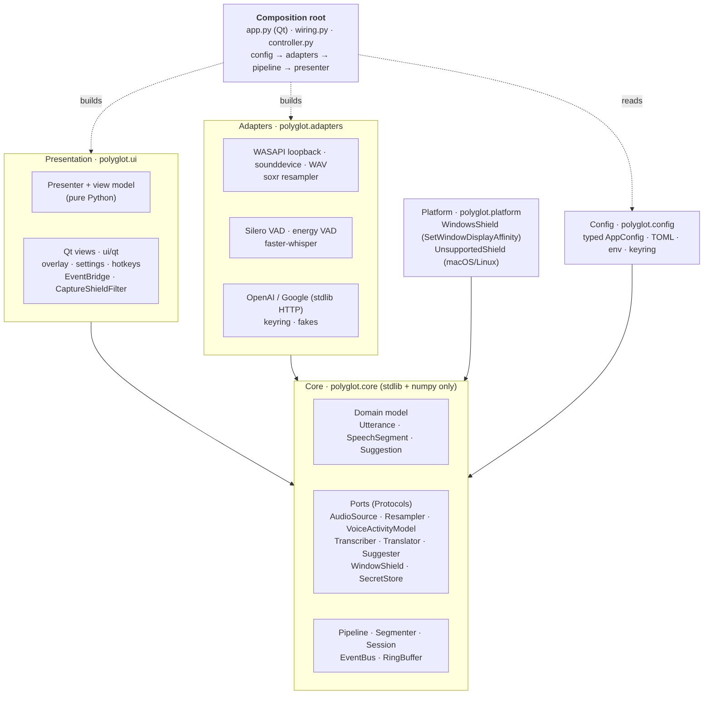
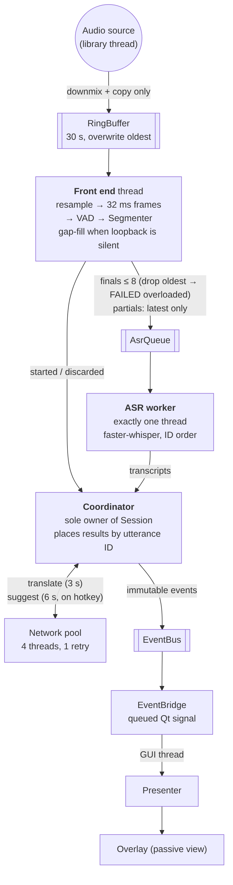

# Polyglot v1 architecture

Polyglot v1 is a pipeline of single-purpose stages around a pure-Python core. Imports
point inward only, there is one thread bridge to the UI, and only the coordinator writes
conversation state. This document describes what is built. The design rationale and the
critique of v0 that motivated it are in the "Polyglot v1 — Architecture Design" doc.

## Layers



(Sources: `v1-layers.mmd`, `v1-pipeline.mmd`; render with `mmdc -i <file> -o <png>`.)

| Layer | Package | May import | Knows about |
| --- | --- | --- | --- |
| Core | `polyglot.core` | stdlib, numpy | nothing outside itself |
| Adapters | `polyglot.adapters` | core + its own library (lazily) | one technology each |
| Platform | `polyglot.platform` | core, ctypes | the OS |
| Config | `polyglot.config` | core, pydantic, platformdirs | settings and secrets |
| Presentation | `polyglot.ui` | core (`presenter` is Qt-free; `ui.qt` adds PyQt6) | view model, widgets |
| Composition | `wiring`, `controller`, `app`, `__main__` | everything | which concrete class goes where |

**The dependency rule is a test.** `tests/unit/test_architecture.py` parses every module's
imports and fails the build if the core imports anything but the standard library and
numpy, if an adapter or the platform layer imports the UI, or if the UI reaches into
adapters. OS checks (`sys.platform ==`) outside `polyglot.platform` also fail it.

### Module map

```
src/polyglot/
  __main__.py          CLI: GUI, --demo, --headless, --file, --list-devices
  app.py               Qt composition root: window, presenter, bridge, tray, hotkeys
  wiring.py            config -> adapters -> Pipeline (Qt-free); build_demo() for fakes
  controller.py        pipeline lifecycle; applies settings; rebuilds keeping the conversation
  config.py            AppConfig (pydantic), TOML load/save, env overrides, Secrets
  logging_setup.py     rotating file + stderr; no transcript text by default
  core/
    models.py          Utterance, SpeechSegment, Transcript, Suggestion, ReplyOption, IdSource
    errors.py          ProviderTimeout, ProviderUnavailable, QuotaExceeded, AuthError, ...
    events.py          UtteranceUpdated, SuggestionsReady, PipelineStatus, StageError, EventBus
    ports.py           AudioSource, Resampler, VoiceActivityModel, Transcriber, Translator,
                       Suggester, WindowShield, SecretStore
    ringbuffer.py      preallocated SPSC audio ring buffer with overrun accounting
    segmenter.py       VAD endpointing state machine (pure)
    session.py         conversation state + language lock policy
    languages.py       code <-> name
    pipeline.py        FrontEnd, AsrQueue, AsrWorker, Coordinator, Pipeline
  adapters/
    audio/             wasapi_loopback, sounddevice_source, playback (WAV/array), resample (soxr)
    vad/               silero (onnxruntime), energy
    asr/               faster_whisper
    translate/         openai, google
    suggest/           openai (JSON-schema structured output)
    http.py            stdlib HTTPS client + status -> typed error mapping
    secrets.py         keyring store, memory store
    fakes.py           a working fake for every port
    dump.py            optional per-utterance WAV dumps
  platform/            WindowsShield (SetWindowDisplayAffinity), UnsupportedShield
  ui/
    presenter.py       Presenter, RowVM, SuggestionVM, StatusVM, ViewPort, Commands
    qt/                overlay, settings_dialog, bridge, shield_filter, hotkeys, theme.qss
```

## Domain model

`Utterance` is the unit of work: one continuous stretch of the other person's speech.
It is a frozen dataclass. Every change makes a new copy, so a snapshot handed to
another thread can never change underneath it.

| Status | Meaning |
| --- | --- |
| `LISTENING` | speech started, no text yet |
| `PARTIAL` | provisional text (only when partials are enabled) |
| `FINAL` | endpoint reached, text fixed; `error` set if translation failed |
| `TRANSLATED` | translation attached |
| `FAILED` | transcription failed or the utterance was dropped under overload |

Utterance IDs come from one monotonic `IdSource` and define spoken order. Results are
placed by ID, never by arrival time.

## Pipeline



| Thread | Job | Must never |
| --- | --- | --- |
| audio library callback | downmix and copy the block into the ring buffer | allocate per sample, log, touch disk |
| `polyglot-frontend` | resample to 16 kHz, cut 32 ms frames, VAD, segmenter, route | transcribe |
| `polyglot-asr` (exactly one) | load the model, transcribe segments in ID order | run in parallel with itself |
| `polyglot-net-*` (4) | translation and suggestion calls with timeouts | write state |
| `polyglot-coord` | own `Session`; apply results; dispatch; publish events | block on I/O |
| Qt main thread | receive events through `EventBridge`; presenter; view | (not part of the pipeline) |

### Endpointing (`core/segmenter.py`)

| Rule | Default | Config |
| --- | --- | --- |
| start: probability ≥ start threshold for N frames | 0.5 × 3 frames (~100 ms) | `vad.start_threshold`, `vad.start_frames` |
| pre-roll kept before the start | 300 ms | `vad.pre_roll_ms` |
| end: probability < end threshold for this long | 0.35 for 600 ms | `vad.end_threshold`, `vad.end_silence_ms` |
| force-cut at the quietest frame of the last 2 s | 15 s | `vad.max_utterance_s` |
| discard if less speech than | 300 ms | `vad.min_utterance_ms` |
| partial transcripts every | off | `vad.partial_interval_ms` |

**Gap fill.** WASAPI loopback delivers no data at all while nothing is playing. Without
help, an utterance whose speaker stops talking would never see its 600 ms of silence. The
front end therefore feeds real-time-equivalent silence while an utterance is open and no
audio has arrived for 250 ms (`audio.gap_fill`).

### Ordering, staleness and backpressure

* Every result carries its utterance ID; the coordinator places it by ID.
* Nothing is dropped for being late. A late translation fills its own row.
* Suggestions run only on the hotkey, for the latest final utterance, with the last 6
  final utterances as context. A reply stays linked to the sentence it answers. If newer
  sentences arrive first, the presenter marks it "newer sentences since". Pressing the
  hotkey again supersedes an in-flight request: its result is ignored, since the newer
  request wins.
* Older partials are skipped (a newer partial or the final covers the same audio).
* Ring buffer: 30 s; on overrun the oldest audio is overwritten, counted, and a
  `FALLING_BEHIND` status is published.
* ASR queue: at most 8 waiting finals. When full, the oldest is dropped, marked
  `FAILED(overloaded)`, and `FALLING_BEHIND` is published. Latency stays bounded instead of
  growing for the whole session.
* Network: hard timeouts (translation 3 s, suggestions 6 s) and one retry with jitter
  for retryable errors.

### Lifecycle

`Pipeline.start/stop` control listening (source, front end, ASR worker). The coordinator
and session outlive them, so suggestions and language commands keep working while
stopped. `stop` finishes and transcribes the utterance in progress. When a settings change
needs a new pipeline, the controller passes the old `session` and `ids` to the new one,
so the conversation continues and IDs keep increasing.

## Presentation

Model–View–Presenter with a passive view:

* `EventBridge` is the only thread bridge. It subscribes to the bus and re-emits each event
  as a queued Qt signal, so delivery happens on the GUI thread.
* `Presenter` (pure Python, unit-tested) keeps the view model, formats it (language names,
  error wording, "translating…", "Replying to: …") and turns clicks and hotkeys into
  `Commands`.
* `OverlayWindow` draws rows by ID, the suggestion panel, a status strip and the capture
  indicator. It emits intent signals and holds no logic.

## Platform layer

| Concern | Windows | macOS | Linux |
| --- | --- | --- | --- |
| System audio | WASAPI loopback (PyAudioWPatch), follows the default output | BlackHole via `SoundDeviceSource` | any input device |
| Hide from screen capture | `SetWindowDisplayAffinity(WDA_EXCLUDEFROMCAPTURE)` on every top-level window, on show and on handle change, read back with `GetWindowDisplayAffinity` | not attempted (ScreenCaptureKit ignores `NSWindow.sharingType` on macOS 15+) | not attempted |

On Windows builds before 19041 the same call would put a black box in the share, so it is
skipped. Whenever the window is not hidden, the footer says "Visible in screen share".

## Errors, logging, privacy

* Ports raise typed errors (`core/errors.py`). Failures show as failures (row note, status
  strip) and are never replaced with made-up text.
* No modal dialogs mid-conversation; the only modal dialog is the quit confirmation while listening.
* Logs: module loggers, rotating file in the user log directory. INFO carries IDs and
  timings (`utt=3 final asr_ms=412`), never transcript text.
* Translation and suggestions are off until enabled. Only text is sent to providers.
  Keys live in the OS keyring. Audio dumps are off by default and go to the user data
  directory.

## Testing

| Suite | What | Needs |
| --- | --- | --- |
| `tests/unit` | segmenter rules, ring buffer, session, events, AsrQueue, config, presenter, controller, architecture rule | nothing |
| `tests/pipeline` | the threaded pipeline end to end with fakes: pairing under out-of-order completion, single ASR worker, language lock, retries, overload, suggestions (supersede, late, failure), clear, stop/restart, gap fill, resampled stereo input, error reporting | nothing |
| `tests/adapters` | HTTP error mapping, OpenAI/Google/suggester request and response handling, WAV I/O, playback, resampling, VAD, Windows shield (fake user32), keyring store | soxr/Silero tests skip if absent |
| `tests/ui` | overlay rows and panels, bridge delivers on the GUI thread, shield filter covers dialogs, settings dialog, demo-mode app smoke test; real shield on Windows | PyQt6 + pytest-qt (offscreen) |
| `tests/integration` (`-m slow`) | Silero and Whisper `tiny` on espeak-synthesized speech, end to end | faster-whisper, espeak-ng |

## Implementation decisions beyond the design doc

| Decision | Why |
| --- | --- |
| HTTP via the standard library behind an `HttpClient` interface, not the OpenAI SDK or httpx | Two REST calls do not justify the SDK's dependency tree; tests inject a fake transport |
| Config via plain pydantic models plus a small TOML writer, not pydantic-settings / tomli-w | The precedence rules are ~30 lines; fewer dependencies |
| Resampling behind a `Resampler` port, built per source rate | Keeps the core numpy-only and lets tests resample without soxr |
| Silero loaded from faster-whisper's bundled model, both v4 and v5 interfaces detected | No extra download; falls back to the energy VAD with a visible warning if it cannot load |
| Coordinator outlives start/stop | Suggestions and language commands work while not listening |
| Gap fill in the front end | Loopback delivers nothing during silence; utterances must still end |
| Suggest requests supersede each other (generation counter) | One request at a time; the newest press wins |
